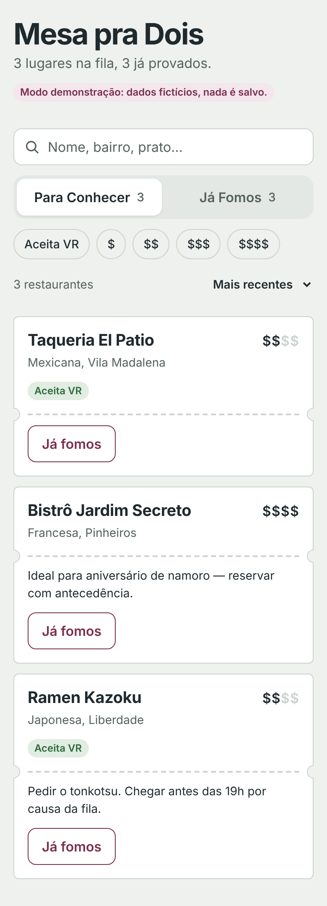
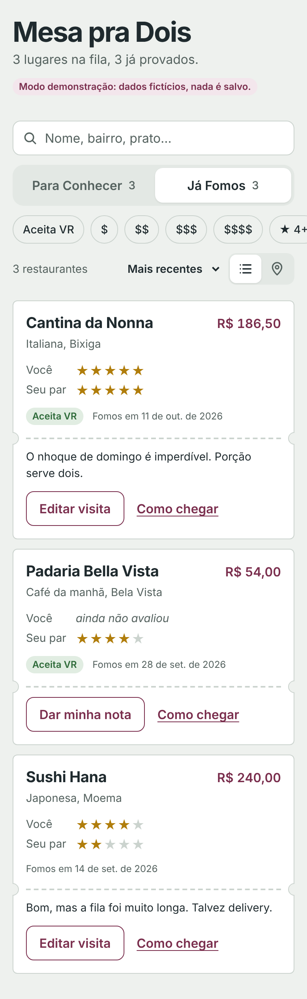
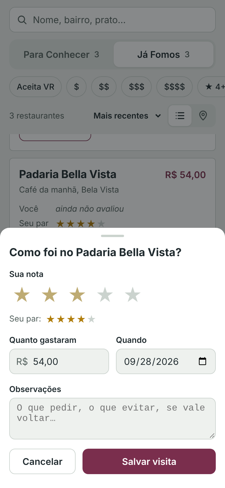
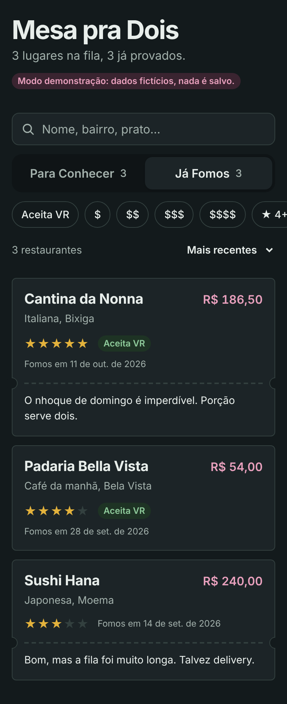

# Mesa pra Dois

Diário e planejador gastronômico para um casal: lista "Para Conhecer", lista "Já Fomos", sincronizada em tempo real entre as duas contas.

**Stack:** React 19 + TypeScript + Vite · CSS Modules com design tokens · Supabase (Postgres, Auth, Realtime, RLS) · Leaflet + OpenStreetMap · Vitest.

**Recursos:** login com e-mail e senha · conta de casal com código de convite · adicionar, editar e excluir restaurantes com busca de endereço · duas listas com busca e filtros (VR, preço, média 4+) · uma nota por pessoa (com média do casal) · registro de visita (nota, gasto, data, observações) · mapa com link "Como chegar" · sincronização em tempo real entre os dois.

| Para Conhecer | Já Fomos | Registrar visita | Tema escuro |
|---|---|---|---|
|  |  |  |  |

## Rodar

```bash
npm install
npm run dev        # sem .env: modo demonstração (dados fictícios em memória)
npm test           # testes das regras de domínio
npm run build      # typecheck + build de produção
```

## Conectar ao Supabase

1. Crie um projeto em supabase.com (plano Free, região São Paulo).
2. SQL Editor → rode, nesta ordem, `001_init.sql`, `002_ratings_and_location.sql`, `003_categories.sql` e `004_google_place_id.sql` (pasta `supabase/migrations`).
3. Authentication → URL Configuration: *Site URL* = endereço do app na Vercel; em *Redirect URLs*, adicione também `http://localhost:5173`.
4. Local: copie `.env.example` para `.env` e preencha `VITE_SUPABASE_URL` e `VITE_SUPABASE_ANON_KEY` (Project Settings → API Keys). Use só a chave **anon/publishable**, nunca a `service_role`.
5. Vercel: Settings → Environment Variables com as mesmas duas variáveis → Redeploy (o Vite lê as variáveis no build).

Com o Supabase configurado, o app pede login e os dados de exemplo não aparecem.

## Geoapify (opcional, recomendado)

Com `VITE_GEOAPIFY_API_KEY`, a busca de endereço vira autocompletar (enquanto digita) e o mapa usa o visual do Geoapify. Plano grátis: 3.000 créditos/dia, sem cartão; cada busca = 1 crédito, cada quadradinho do mapa = 0,25. Restrinja a chave aos sites do app no painel do Geoapify.

## Google Maps (opcional)

Com `VITE_GOOGLE_MAPS_API_KEY` e `VITE_GOOGLE_MAP_ID`, a busca de endereço vira autocompletar do Google Places (API nova) e o mapa passa a ser o do Google. Tem prioridade sobre o Geoapify. Sem nenhuma chave, busca e mapa usam o OpenStreetMap.

- APIs a ativar no Google Cloud: **Places API (New)** e **Maps JavaScript API**
- Restrinja a chave por site (`https://SEU-APP.vercel.app/*`, `http://localhost:5173/*`) e às duas APIs
- Defina cotas diárias: o orçamento só avisa, quem bloqueia cobrança é a cota
- Custo: a busca usa token de sessão e pede só campos da faixa *Essentials*

## Arquitetura

```
src/
├── app/                      # composição raiz (App) e AuthGate: login → casal → app
├── pages/HomePage/           # página = conecta hooks a componentes
├── features/auth/            # login e cadastro
├── features/couple/          # criar/entrar no casal, convite, sessão do casal (Context)
├── features/restaurants/     # tudo da feature junto (feature-first)
│   ├── types.ts              # modelo de domínio
│   ├── domain/               # regras puras + testes (sem React, sem banco)
│   ├── data/                 # Repository: contrato + Supabase + memória
│   ├── hooks/                # estado e efeitos (useRestaurants, filtros, ações)
│   └── components/           # apresentação
├── shared/ui/                # componentes genéricos (BottomSheet, Chip, StarInput…)
├── shared/lib/               # utilitários (formatação, cliente Supabase)
└── styles/                   # tokens.css (design system) + global.css
```

Regra de dependência: `components → hooks → data/domain`. O domínio não importa nada de fora; só `data/` conhece o Supabase.
